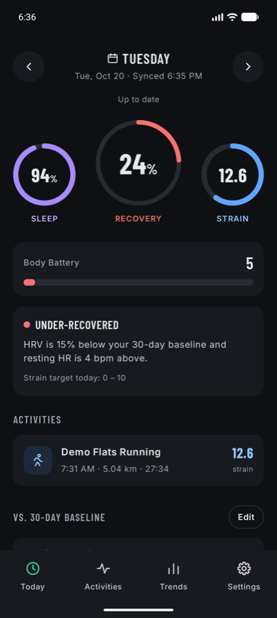
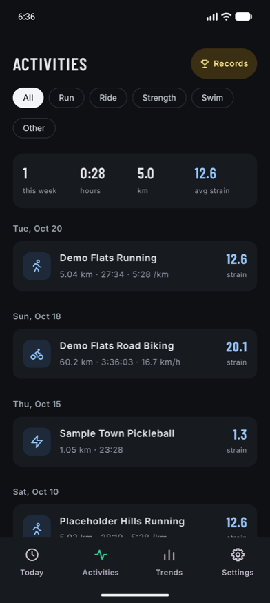
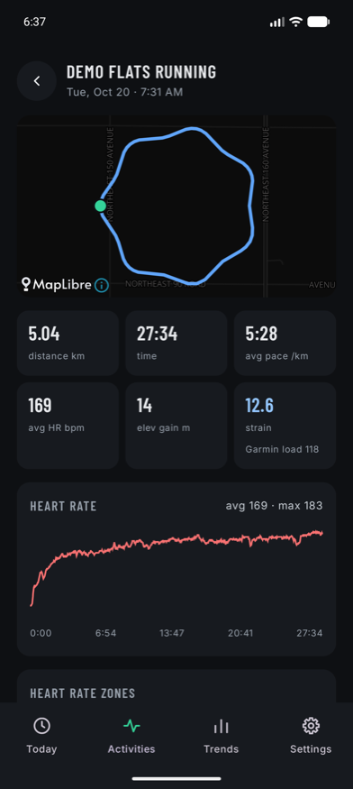
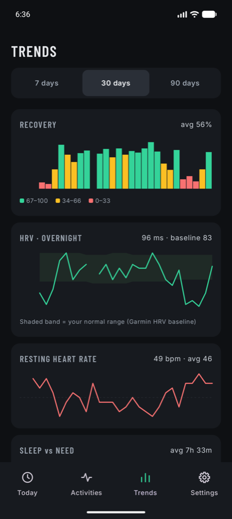
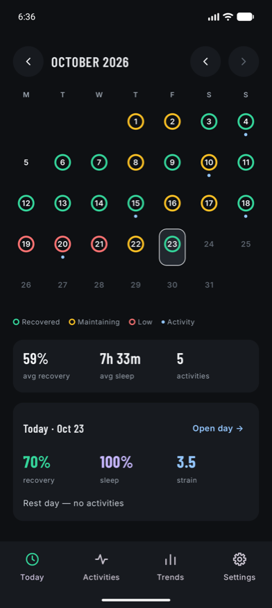

<h1 align="center">Baseline</h1>

  <b>Your Garmin data, finally explained.</b> 
  Recovery, sleep and strain scores on a calm daily dashboard. Private, on-device, no account.

  
  
  
  

  
  
  
  
  

Screenshots use anonymized sample data.

---

You wear a Garmin all day and all night. It records heart rate, HRV, sleep, stress, Body Battery and every workout. Then you open an app and get a pile of numbers.

**Baseline turns them into three answers:**

| 🟢 Recovery | 🌙 Sleep | 🔥 Strain |
|---|---|---|
| Are you ready to push today, or should you take it easy? | Did you sleep as much as your body needed? | How hard did you work, on a 0–21 scale? |

If you've used a WHOOP, the idea will feel familiar. The difference is that it runs on your Garmin, and your data never leaves your phone.

## ✨ What you get

- **Today.** Three dials up top, then a list of stats you arrange yourself: HRV, resting heart rate, Body Battery, steps, stress and more. Drag to reorder, tap the eye to hide what you don't care about.
- **Activities.** Every workout with its heart-rate zones, splits and, for anything outdoors, a route map.
- **Trends.** Weeks and months of recovery, sleep against sleep need, strain and heart rate, so you can see what's actually changing.
- **Calendar.** A month at a glance: a ring per day coloured by recovery, a dot for every activity.
- **Records.** Your all-time bests, like that fastest 5K, kept up to date for you.
- **Your baseline, not someone else's.** Recovery is measured against your own last 30 days of HRV, resting heart rate and respiration. The strain scale is calibrated to your history, so your 90th-percentile day lands at about 17.

## 🔒 Private by design

- **No backend.** There is no Baseline server. Nothing to sign up for, nothing to breach.
- **No analytics, no ads, no tracking.**
- **Your key is encrypted** with the Android Keystore and only ever sent to Garmin.
- **Everything is calculated on the phone.** The only network calls are to the Garmin Personal API and, for route maps, to the free OpenFreeMap tile server.
- **Raw data is kept** next to the scores, so better scoring can be applied to your history later without fetching it all again.

## 🚀 Get started

1. Download the latest APK from the [Releases](https://github.com/marcusHamilton/baseline/releases/latest) page and install it. Android 10 or newer.
2. Get a **Garmin Personal API key** from [Garmin Connect settings](https://connect.garmin.com/app/settings/personalApiToken).
3. Open Baseline, paste the key once, and let it sync. The first run pulls your history, then it stays up to date in the background.

That's it. Want to look around before you hand over a key? Run the [fake Garmin server](CONTRIBUTING.md#try-it-without-a-garmin-key) and Baseline fills up with sample data.

## 🛠 Under the hood

Kotlin and Jetpack Compose, Room for storage, WorkManager for sync, Garmin's FIT SDK for activity files, Vico for charts and MapLibre for maps. Nothing is shipped to a server, because there isn't one.

Curious how the scores work? The formulas, data sources and design decisions are all written down in the [design spec](docs/superpowers/specs/2026-10-24-baseline-android-design.md).

## 🤝 Contributing

Bug reports, ideas and pull requests are welcome. Setup, tests, conventions and the rules that protect users' data are in [CONTRIBUTING.md](CONTRIBUTING.md).

## ⚠️ Unofficial

Baseline is an independent project. It is not affiliated with, endorsed by or connected to Garmin Ltd. or WHOOP. Garmin and Garmin Connect are trademarks of Garmin Ltd. or its subsidiaries; WHOOP is a trademark of Whoop, Inc. They are named here only to describe compatibility and inspiration. Scores are computed locally, are not Garmin's or WHOOP's metrics, and are not medical advice.

## 📄 Licence

MIT, see [LICENSE](LICENSE). Bundled fonts and other third-party material are covered in [THIRD_PARTY_NOTICES.md](THIRD_PARTY_NOTICES.md).
